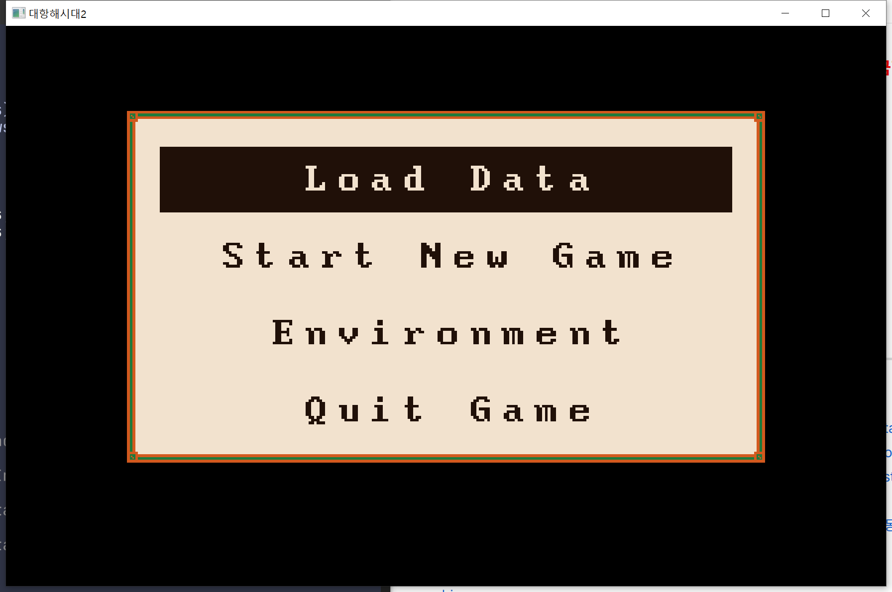
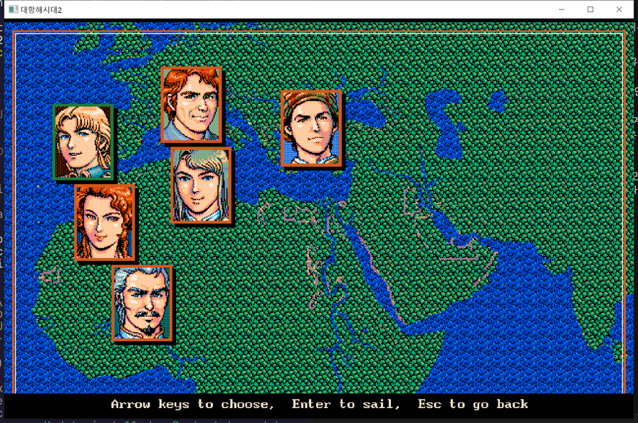
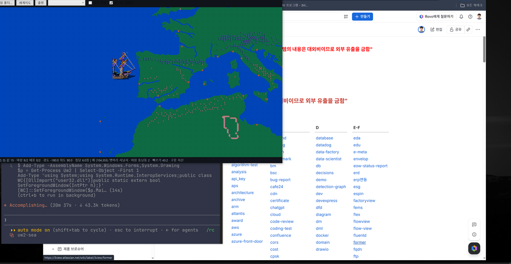
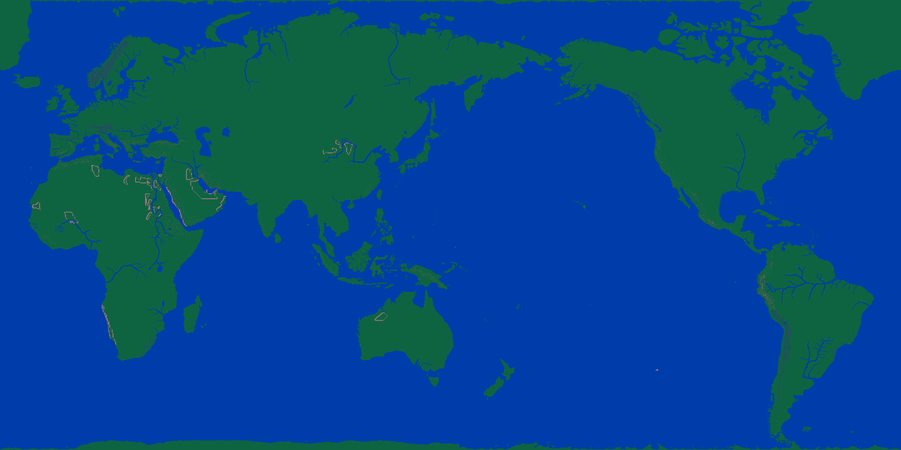

# Uw2 — 대항해시대2 세계지도·항구를 Direct3D 로

 





KOEI 『대항해시대II』(1993) 의 자산을 읽어 **세계지도와 항구 화면을 Direct3D 11 로** 그린다.

## 무엇이 되나

원본 `KOUKAI2.EXE` 를 뜯어 **셈을 그대로** 옮기는 것이 목표다. 주소는 일본어판 EXE 기준이고 `docs/` 에 하나씩 적었다.

- **항해** — 빠르기 셈(돛 효율표 · 돛 성능 · 선원 · 짐 · 항해 레벨 · 항해술 · 역풍 성능)과 걸음(칸 안 0~59, 해류는 걸음에 더한다)이
  원본 그대로다. 바다는 칩 2 x 2 넷이 다 바다여야 간다(해안 칩은 막힌다). 바람은 네 시간마다 흔든다. (docs/12 · 14)
- **시각과 날짜** — 하루 72틱, 틱마다 (빠르기+1) x 20 ms. 1522년 May 17일 아침 8시에 시작하고 2월은 늘 28일(원본 윤년 셈 버그). (docs/17)
- **날씨** — 폭풍 · 무풍 · 안개가 조짐 → 들이닥침 → 걷힘으로 흐르고 항해사가 MESSAGE.DAT 대사로 알린다. (docs/18)
- **남 함대** — 새 게임의 일흔 함대 가운데 바다에 나온 것이 뱃길 그래프(DATA1.LZW 4번 청크, 마디 622)를 따라 항구를 오간다.
  빠르기 · 뱃머리 선 긋기도 원본 셈이다. (docs/19)
- **주인공** — 여섯 사람이 얼굴(`KAO.LZW`)을 달고 고향 항구 위에 놓인다. 첫 배는 시나리오 바이트코드(`SNRn.DAT`)의
  배 주기 명령에서 읽는다 — 카탈리나만 갤리온, 나머지는 카라벨 라티나. (docs/16 · 21)
- **도시** — 걸음 판정은 칩 벌마다의 경계(`PORTCHIP.LZW`), 문은 `ZA_DAT.DAT`. 문에 서면 그 건물의 `MENU.DAT` 목록이 뜨고,
  건물마다 여는 시각이 있다. (docs/13 · 15)
- **교역** — 항구마다 파는 교역품과 사는 값 · 파는 값(시장 13 · 항구 형편 100), 사고팔기, 항 「보급」, 조선소 「함선 건조」(열 척까지, 선원 없이 온다), 주점 「선원 고용」, 은행(예금 3% · 빚 10% 달마다), 교역소 「투자」 · 조선소 「공업투자」(나라 몫이 오르고 달마다 경제 · 공업이 자란다). (docs/20)
- **시나리오** — 건물에 들면 그 항구 · 건물에 걸린 이벤트를 먼저 돌린다(`SNRn.DAT` · `.MES`). 대사 · 얼굴 · 고르기 · 깃발 · 다음 절 · 장. (docs/21)
- **지도** — 세계지도 2160 x 1080 칩 · 항구 101곳을 Direct3D 11 로. `A` 키로 바람 · 해류 화살표. 원본 열여섯 색 팔레트.

## 자산

`asset/` 에 구워 둔 것이 들어 있어 **게임이 없어도 돈다**(584 KB, 서른두 개).
거의 다 **색인 PNG** 라 값이 그대로 남으면서 여기서 그림으로도 보인다.

```
asset/
  palette.png        16x1     열여섯 색
  font.png           128x96   8x16 글자 아흔여섯 자
  char.png           256x32   32x32 사람 그림 여덟 장(쪽 넷 x 걸음 둘)
  ship.png           64x80    배 그림
  ports.json                  항구 130곳 이름·자리
  monsters.json               괴물 자리 서른 곳
  ships.json                  선종 스물다섯 (SDATA.DAT)
  people.json                 사람 백스물 — 능력치 · 레벨 (SDATA.DAT)
  wind.png           30x45    바람·해류 표 셋
  world/cells.png    1080x540 칸 값
  world/chips.png    256x128  칩 128장
  world/quad.png     256x4    그림표
  port/maps.png      1056x960 항구지도 101장
  port/chips-0..6    256x240  칩 벌 일곱
  port/chipno.png    100x1    항구 → 칩 벌
  port/walk.png      4x7      칩 벌마다 걸음 경계
  port/doors.png     24x101   항구마다 문 열둘 (ZA_DAT.DAT)
  kao/faces.png      1024x640 얼굴 64x80 백스물여덟
  kao/finds.png      768x384  발견물 그림 48x48 백스물여덟
  world/route.png    16x622   뱃길 그래프 마디
  fleets.png         133x70   새 게임 함대 일흔
  start-ships.json            선종 본보기 · 주인공 첫 배 · 첫 돈(SNRn.DAT)
  goods.json                  교역품 마흔여섯
  markets.png        128x13   시장 열셋
  portstate.png      37x100   항구 형편 백
  menus.json                  MENU.DAT 고르기 목록 예순하나
```

제 게임 폴더에서 다시 구우려면 `uw2 assets <게임폴더> asset <원판폴더>` 다.

## 쓰는 법

```
dotnet build
dotnet run --project Uw2
dotnet test Uw2.Tests      원본 셈 · 구운 자산을 검산한다
```

`asset/` 이 있으면 그것으로 열고, 없으면 게임 폴더를 찾는다(바탕화면 `DH2W95Kor_Win_Test2` 따위).
**DOS 원판과 Win95 이식판을 다 받는다** — 갈리는 것은 칩 담는 꼴뿐이고 그것은 알아서 가린다.

| 키 | 것 |
|---|---|
| `F` | 온 지도 보기 |
| `G` | 격자 |
| `A` | 바람·해류 화살표 (위 바람 · 아래 해류) |
| `C` | 칩 / 민색 |
| `W` | 세계지도로 |
| `L` | 리스본 항구 |
| `S` | 출항 |

바다에 나와 있으면 방향키가 **뱃머리**를 잡는다 — `←` `→` 한 칸씩 돌리고, `↑` 북 `↓` 남,
`Space` 로 돛을 접었다 편다. **항구 안에서는 방향키가 사람을 걷게 한다.**
첫 메뉴·주인공 고르기에서는 방향키와 `Enter`, `Esc` 다.

### 손도구

```
uw2 list   <폴더>                      묶음마다 청크 목록
uw2 unpack <파일.LZW> <낼 곳>           청크를 .bin 으로
uw2 map    <폴더> <낼 곳.bmp>           세계지도를 그림으로
uw2 chips  <파일.LZW> <낼 곳.bmp>       칩 벌을 그림으로
uw2 ports  <폴더>                      항구 130곳의 이름·자리·칩 벌
uw2 port   <폴더> <번호> <낼 곳.bmp>    항구 하나를 그림으로
uw2 bake   <폴더> <낼 곳>               칸 지도·칩 아틀라스 굽기
```

## 프로젝트

| 프로젝트 | 것 |
|---|---|
| `Uw2` | 보기 껍데기(WinExe) |
| `Uw2.Play` | 놀이 껍데기(`Uw2Play.exe`) |
| `Uw2.Game` | Direct3D 11 렌더러 + 엔진 |
| `Uw2.Support` | 파일 포맷 읽개 |
| `Uw2.Tools` | 손도구 `uw2.exe` |

렌더러는 정점 버퍼 없이 삼각형 하나로 화면을 덮고, 픽셀 셰이더가
**화면 점 → 칸 → 칩 → 칩 안 점 → 팔레트** 차례로 짚는다. 칸이 화면 몇 점이든 그때 칩에서
점을 뽑으므로 확대해도 원본 그림이 그대로다. 창은 `HwndHost` 자식 창에 DXGI 스왑체인을 건다.

## 자산 짜임

Win95 이식판 `KOUKAI2.EXE` 가 평범한 32비트 PE 라, 거기서 규칙을 읽어 옮겼다.

```
WORLDMAP.LZW ─(LS11)→ 청크 3장 ─(조각 12×12 + 본보기 6벌)→ 칸 1080×540
   └─ 칸 값 ─(2×2 자국 또는 DATA1[18] 그림표)→ 칩 2160×1080
        └─ 칩 번호 ─(DATA1[11] 16×16)→ 색인 0~15
             └─ 팔레트 ─→ 색
```

| 것 | 알아낸 것 | EXE 자리 |
|---|---|---|
| 압축 | 엘리아스 감마꼴 부호를 쓰는 LZ77. 이름은 LZW 지만 사전을 안 키운다 | `0x0041C240` · `0x0041C290` |
| 지도 | 12×12 조각 4,050장을 90×45 로. 자국이 꺼진 칸은 **본보기 조각**에서 온다 | `0x0041DD00` · 표 `0x004582D8` |
| 칩 | 칸 하나가 2×2 칩. 값 < 16 은 네 비트가 뭍 자국, 그 위는 그림표 | `0x0041DE78` |
| 그림표 | `DATA1.LZW` 18번 청크, 256칸 × 4바이트 | `0x00415BC0` |
| 바람 | 450바이트 표 **셋**(철 따라 갈리는 바람 둘 + 해류). 격자 30×15 | `0x0041E270` |
| 색 | 색 하나가 세 바이트(파랑·빨강·초록), 성분마다 네 비트 | DOS `MAIN.EXE` `0x156B` |
| 사람 | `CHAR.LZW` 청크 하나가 사람 하나. 16×16 조각 예순넷인데 짝수가 그림, 홀수가 가림장. 조각 넷을 붙여 32×32 한 장 | — (자료로 캤다) |

자세한 것은 `docs/` 를 볼 것.

## 아직 안 된 것

- 시나리오 기계 — 게임 기억 가리키개(D0 · DC)와 그것을 읽는 변수 갈래 1 은 아직 0 으로 읽는다. 첫 돈은 어림이다(docs/21).
- 건물 안 — 교역소 · 항 · 조선소 「함선 건조」 · 「중고선 구입」 · 「수리」 · 「매각」 · 「공업투자」, 주점 「선원 고용」 · 「항해자와 대화」, 여관 「항해자와 대화」, 은행 말고는 목록만 뜬다. 개조 · 결투 · 승무원 편성 따위.
- 날마다 식량 · 물이 줄고 사기가 떨어지는 셈(`0x00417480`), 폭풍이 배를 치는 셈(내구).
- 싸움, 발견물, 세이브.

## 만든 것

.NET 10 · WPF · [Vortice.Windows](https://github.com/amerkoleci/Vortice.Windows) (Direct3D 11)
