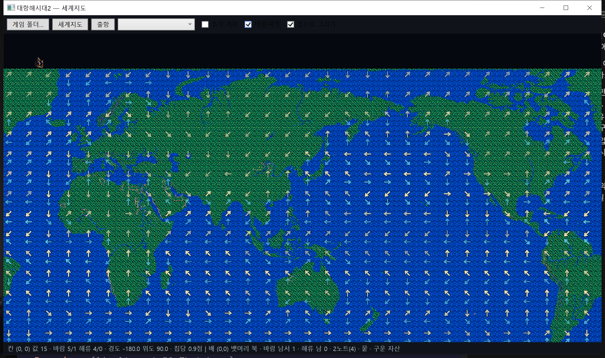

# 항해 속도와 걸음 (KOUKAI2.EXE)

옮긴 자리: `Uw2.Game/Engine/Sea/Sailing.cs` · `Fleet.cs` · `Uw2.Support/Local/Formats/StartData.cs`.

## 바람 · 해류 바이트

`WINDCUR.DAT` 한 칸(30 x 15, 칸마다 72 x 72 칩)은 이렇게 갈린다. 흔드는 손 `0x00418E80`,
그림 찍는 손 `0x004366D0` → `0x00436740(y, 방위, 세기)` 이 근거다.

| 비트 | 것 |
|---|---|
| 0..2 | 세기 0~7. 바람 장에는 0 이 없다. 해류는 0~5 |
| 3..5 | 방위 0~7. 0 이 북, 시계 방향. **밀어가는 쪽** |
| 6·7 | 날씨 깃발. 날씨가 걸려 있으면 흔드는 손이 이 두 비트만 표에서 새로 가져온다 |

예전 읽개는 16방위 · 세기 0~3 으로 읽었는데 틀렸다.



달 4(May) 바람(위 화살표)과 해류(아래). 북위 15~20도 태평양의 무역풍이 서쪽으로, 남위 40~50도의 편서풍이 동쪽으로,
남동 무역풍이 북서쪽으로 선다 — 방위가 밀어가는 쪽이라는 것과 비트 가름이 맞다.

방위의 걸음 표: dx `0x00456EE0` = `0 1 1 1 0 -1 -1 -1`, dy `0x00456EE8` = `-1 -1 0 1 1 1 0 -1`.
대각선도 두 축으로 한 칸씩이다(길이를 안 맞춘다).

바람 흔들기(`0x00418E80`).

```
세기 = min(7, 표 세기 + rand(2))
방위 = (표 방위 + rand(5)/4 x (rand(3)-1)) & 7     열다섯 번에 한 번꼴로 한 칸 돈다
```

## 제 함대 빠르기 — 0x00448520(뱃머리, 풍향, 풍속, 해류방위, 해류세기)

배 열 칸을 돌며 배마다 셈하고 **가장 작은 값**을 고른다.

```
각 = |풍향 - 뱃머리|                       0~7 (8방위라 둘레가 맞는다)
노 젓는 배면 풍속 = max(3, 풍속)
v = 효율표[각][돛 갈래] x 돛성능 x 풍속 / 150
v = v x min(100, 선원 x 돛 몫% / 드는 선원) / 100
v = v x min(150, 180 - 짐 x 100 / 짐칸) / 100
v = min(30, v + v x 항해 레벨 / 10)          선장(그 배에 탄 사람)
v = min(40, v x 항해술 / 75)
각이 3~5 면 v = v x 역풍성능 / 100
함대 = max(2, 최소)    풍속 0 이고 노 젓는 배가 없으면 0
```

화면 노트 = `(빠르기 + 1) / 2` (`0x0043410F`). 효율표는 `0x00456EA0`(8 x 8).

```
각\돛  0  1  2  3  4  5  6  7
0     10  8 10  9  9  8 10 10
1     10  9 10 10 10 10 10 10
2      8  9 10 10 10 10 10 10
3      6  7  8  9  9 10  9 10
4      4  6  6  7  7  8  9 10
5~7   3·2·1 줄과 같다
```

## 걸음 — 0x00448BC0 · 0x004487B0

함대 기록 +0 · +2 가 칩 칸, +0x18 · +0x19 가 칸 안 걸음(0~59)이다.

```
걸음 = 방위[뱃머리] x 빠르기 + 방위[해류] x 해류세기
칸 안 걸음 + 걸음 이 60 을 넘거나 0 아래면 그 축으로 한 칸
새 칸이 뭍(0x00448310) 이면
    두 축으로 한 칸씩 간 대각선 칸을 본다 — 뭍이면 못 간 것
    열렸으면 자리는 두고 넘친 축의 걸음을 칸 끝(59 / 0)에 붙인다
못 갔으면 뱃머리+1, 뱃머리-1 로 다시. 다 막히면 0x0043C900
```

빠르기는 뱃머리로 한 번만 셈하고, 비낀 방위로 갈 때도 그 값을 쓴다. 경도 보정은 없다.

## 남의 함대 — 0x00418020 · 0x00418250

효율표(`0x00458150`, 값은 같다)는 같이 쓰되 선원 · 짐을 안 보고 **제독 하나**(함대 +0x2A)의 항해 레벨 ·
항해술로 셈한다. 해류는 걸음에 더하지 않고 빠르기에서 더하고 뺀다.

```
해류 각 3~5 (맞흐름)  빠르기 -= min(빠르기-1, 해류세기)
해류 각 0·1·7 (순흐름) 빠르기 += min(40-빠르기, 해류세기)
```

함대 정보 창(`0x00440DDB`)은 이 손을 **풍향 · 풍속 자리를 바꿔** 부른다 — 원본 버그로 보인다.

## 자료가 사는 곳

| 것 | 메모리 | SDATA.DAT |
|---|---|---|
| 사람 50B x 120 | `0x0045A240` | `0x0CAF` |
| 함대 0x85B | `0x0045BE08` | `0x2500` |
| 배 22B | `0x00461560` | — |
| 선종 12B x 25 | `0x00461AF8` | `0x4936` |
| 제 함대 칸 곁 30B x 10 | `0x004610B0` | — |

사람: 이름 13 · 성 13 · `+0x1C` 능력치 일곱(`+0x1D` 항해술) · `+0x24` 항해 레벨 · `+0x25` 전투 레벨.

선종: `+1` 내구 · `+2` 역풍성능 · `+3` 돛성능 · `+5` 드는 선원 · `+6` 짐칸(낱말) · `+8` 최대 선원(?) ·
`+9` 돛 갈래 · `+10` 값(낱말). `+0` · `+4` 는 뜻을 못 굳혔다.

함대 칸(함대 +0x2B, 9B x 10): `+0` 선원(낱말) · `+2/+3` 내구 지금/최대 · `+4` 역풍성능 · `+5` 돛성능 ·
`+7` 배 번호 · `+8` 깃발(`&0x30 == 0x10` 이면 배가 있다). 배를 들이는 손 `0x0042AC30` 이 선종에서 옮겨 적는다.

제 함대 칸 곁: `+9` 돛에 붙은 선원 몫% · `+0x0A` 짐(낱말) · `+0x1B` 선장. 싸움 셈은 `100 - (+9) - (+8)` 을 쓴다
(`0x00410475`) — 2편의 선원 나누기다.

## 남은 것

- 주인공마다 주는 **첫 배**. SDATA 의 주인공 함대는 비어 있어 코드가 준다. 지금은 0번 선종을 임시로 띄운다.
- ~~한 틱이 실제로 몇 초인지~~ — (빠르기+1) x 20 밀리초, 하루 72틱([[17.분석-하루와 틱]]).
- 날씨(폭풍 · 무풍) — `0x0049F598` 아래 네 비트.
