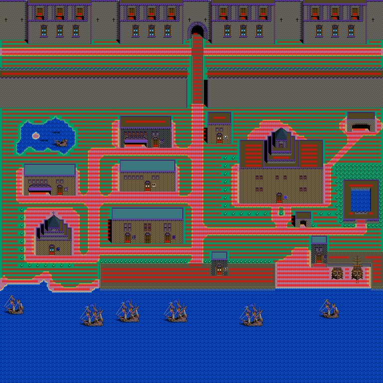

# 도시 걸음 판정 (KOUKAI2.EXE)

옮긴 자리: `Uw2.Support/Local/Formats/PortTables.cs`(`WalkBounds`) · `Uw2.Game/Engine/Town/Walker.cs`.

## 걸음 경계 — PORTCHIP.LZW 의 4바이트 청크

`PORTCHIP.LZW` 는 칩 벌(30,720바이트)과 4바이트 청크가 번갈아 일곱 벌 들어 있다. 4바이트가 그 벌의 **걸음 경계**다.

| 벌 | 0 | a | b | c |
|---|---|---|---|---|
| 0 | 0 | 29 | 34 | 40 |
| 1 | 0 | 21 | 26 | 31 |
| 2 | 0 | 20 | 25 | 30 |
| 3 | 0 | 22 | 26 | 31 |
| 4 | 0 | 37 | 42 | 48 |
| 5 | 0 | 32 | 37 | 46 |
| 6 | 0 | 21 | 22 | 27 |

항구에 들 때 `0x004360A2` 가 칩 벌을 읽고 바로 뒤 청크의 넉 바이트를 `0x0046EDDC` 로 옮긴다(`0x004360C8`).

## 판정 — 0x00432EB0 · 0x00433580

항구지도 담개는 `0x0046EED8`(96 x 96). 사람 그림은 2 x 2 칸이고 **밑줄 두 칸**만 본다
(`0x00433580` 이 `(y + 1) * 96 + x` 와 그 옆 칸을 짚는다). 1 을 돌려주면 막힌 것이다.

```
왼발 = 지도[i],  오른발 = 지도[i + 1]
왼발 >= b                     → 막힘
오른발이 a 이상 b 아래          → 막힘
오른발 >= c                   → 막힘
그 밖                          → 걷는다
```

칩 번호가 쓰임새대로 늘어서 있다는 뜻이다.

| 칩 | 왼발 | 오른발 | 것 |
|---|---|---|---|
| `0 .. a-1` | O | O | 어디든 밟는 바닥 · 길 |
| `a .. b-1` | O | X | 오른쪽이 막힌 가장자리 |
| `b .. c-1` | X | O | 왼쪽이 막힌 가장자리 |
| `c ..` | X | X | 건물 · 벽 · 물 · 나무 |



리스본(벌 0)에서 두 발이 설 수 있는 자리를 붉게 칠한 것이다(칸 하나 오른쪽으로 민 자리가 그림 한가운데다).
풀밭 · 길 · 광장 · 부두가 열리고 건물 · 성벽 · 못 · 바다 · 나무가 막힌다.

예전에는 바닥 · 길 칩이 쓰는 색으로 어림했다(`WalkPurity`). 걷어냈다.

## 남은 것

- ~~걸음이 칸 단위인지~~ — 칸 단위다. 걸음 손(`0x00432FE0`)은 자리(`0x0045A1B0` · `0x0045A1AC`, 화면 안 칸)에 −1 ~ 1 을 더하고
  화면 판(23 x 23, `0x17`)을 벗어나면 넘기고, 옮긴 뒤 0x14(20) 장 걸음 그림을 돌린다(`0x0043312D`). 마을 사람에게 막히면(`0x00432F20`)
  걸음 셈 `0x00459C68` 이 10 이상일 때만 말을 걸고 0 으로 되돌린다 — 우리 `FolkTalkSteps` 와 같다.
  우리도 원본처럼 한 칸씩 걷는다(`Walker.Step_` — 쪽 넷, 둘 다 누르면 가로, 막히면 그 자리, 칸 사이 8 틱). 예전에는 칸의 0.12 씩 미끄러졌다.
- ~~`0x00432EB0`~~ — 칸 번호를 받는 같은 판정이고 마을 사람 걸음이 쓴다(`Townsfolk`, 이미 옮겼다).
