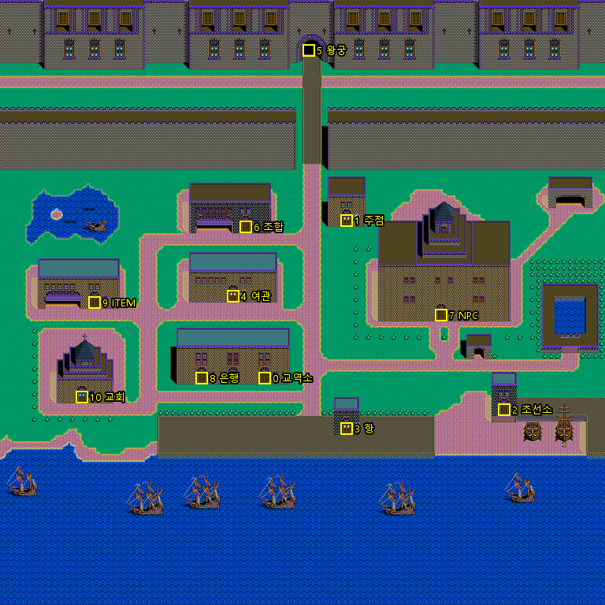

# 건물 문 — ZA_DAT.DAT (KOUKAI2.EXE)

옮긴 자리: `Uw2.Support/Local/Formats/PortTables.cs`(`PortDoors`) · `Uw2.Game/Engine/Town/Walker.cs`(`Building`).

## 파일

`ZA_DAT.DAT` 2,424바이트 = **항구 101곳 x 문 12개 x (x, y) 두 바이트.** `(255, 255)` 는 그 건물이 없는 것이다.

항구에 들 때 `0x00436500` 이 `fseek(항구 x 24)` 뒤 24바이트를 `0x00457450` 으로 읽는다(항구 번호가 100 이상이면 100번 줄).
파일 이름은 `0x0045767C` → `"c:ZA_DAT.DAT"`.

## 판정 — 0x00432BF0

걸음마다(`0x00431ED0` 의 머리) 사람 그림 **왼위 칸**(`화면 자리 0x45A1B0/AC + 굴림 0x45A1B8/B4`)을 열두 문과 견주어
같은 문의 차례를 **건물 번호**로 돌려준다. 없으면 -1.

번호 → 이름은 `MENU.DAT` 의 열두 줄 목록(`0x9C7` 언저리) 그대로다.

| 번호 | 이름 | 번호 | 이름 |
|---|---|---|---|
| 0 | 교역소 | 6 | 조합 |
| 1 | 주점 | 7 | NPC |
| 2 | 조선소 | 8 | 은행 |
| 3 | 항 | 9 | ITEM |
| 4 | 여관 | 10 | 교회 |
| 5 | 왕궁 | 11 | 점술가 |

리스본의 문 열하나(11번 점술가는 없다)를 사람 그림 2 x 2 칸으로 얹은 것이다. 다 문 위에 선다.

## 문에 든 뒤 — 0x00431ED0

`jmp [번호 x 4 + 0x0043212C]` 로 갈래를 타 **여는 시각**을 본다(`0x004703E4`, 하루 72틱 · 한 시간 3틱).
닫혀 있으면 「문이 잠겨 있습니다.」(말 `0x2FD`, `0x00432160`)를 띄우고 들지 않는다.

| 건물 | 여는 틱 | 시각 |
|---|---|---|
| 교역소 · 조선소 · 왕궁 · 조합 · 은행 | 12~59 | 4시~20시 |
| 주점 | 12~23 만 닫음 | 4시~8시만 닫음 |
| ITEM | 6~8 · 24~59 | 2시~3시 · 8시~20시 |
| 교회 | 12~71 | 4시~24시 |
| 점술가 | 48~71 | 16시~24시 |
| 항 · 여관 · NPC | 늘 | 늘 |

열려 있으면 건물 창을 띄우고, 닫으면 사람을 **한 줄 아래로**(`0x00431FA6`) 내린다.
우리는 건물 안이 아직 없어 상태줄에 「들어갔습니다」 또는 「잠겨 있습니다」만 적고 한 칸 물러 나온다.

## 걸음은 칸 단위

걸음 손(`0x00432FE0`)은 한 번에 **한 칸**씩 옮기고, 옮길 칸이 막히면(`0x00433580`) 옆으로 스무 칸까지 비껴
갈 데를 찾는다. 사람과도 부딪친다(`0x00432F20` — 마을 사람 여덟, `0x0049F580` 에 셋 바이트씩).

## 건물 손 — 갈래표 0x00459BF8

열려 있으면 `call [번호 x 4 + 0x00459BF8]` 로 그 건물 손을 부른다(`0x004320DE` · `0x004320EF`).

| 번호 | 건물 | 손 |
|---|---|---|
| 0 | 교역소 | `0x004216F0` |
| 1 | 주점 | `0x00426CA0` |
| 2 | 조선소 | `0x0042A930` |
| 3 | 항 | `0x00423CB0` |
| 4 | 여관 | `0x0041F390` |
| 5 | 왕궁 | `0x00427D20` |
| 6 | 조합 | `0x0041EF70` |
| 7 | NPC | `0x00422910` |
| 8 | 은행 | `0x0041E850` |
| 9 | ITEM | `0x00420250` |
| 10 | 교회 | `0x00421970` |
| 11 | 점술가 | `0x004283E0` |

왕궁 · NPC · 항 · 교회가 아닌 건물은, 그 항구 나라(`항구 +0x15 & 7`, 6 이면 빼고)에서 주인공의 평판(`사람 +6 + 나라`)이
80 아래면 `rand(3) == 0` 이고 `rand(100) > 평판 + 20` 일 때 들지 못한다(`0x00432190`). 들면 「~에 오신 것을 환영합니다」(말 `0x346`).

## 건물 고르기 — MENU.DAT

`MENU.DAT` 머리는 목록 자리(빅엔디언 낱말) 예순하나, 목록마다 `[칸 폭][개수]` 뒤에 글이 0 으로 끊겨 이어진다(`MenuTable`).
건물 손이 고르기 손 `0x0042AB10(번호)` 에 넘기는 목록 번호:

| 건물 | 목록 | 줄 |
|---|---|---|
| 교역소 | 6 | 구입 · 매각 · 투자 · 시세·물가 |
| 주점 | 15 | 선원 고용 · 선원 해고 · 한턱내기 · 항해자와대화 · 여급과 대화 · 도박 |
| 조선소 | 22 | 함선 건조 · 중고선 구입 · 수리 · 매각 · 개조 · 공업투자 |
| 항 | 9 | 출항 · 보급 · 도크 |
| 여관 | 4 | 항해자와대화 · 항구지지율 · 숙박 |
| 왕궁 | 16 | 알현 · 망명 · 자금원조 · 선박원조 · 밀회 |
| 조합 | 1 | 업무 알선 · 나라정보 |
| NPC | — | (없다) |
| 은행 | 0 | 예금 · 출금 · 대출 · 상환 |
| ITEM | 5 | 구입 · 매각 |
| 교회 | 7 | 예배 · 기부 |
| 점술가 | 17 | 인생운 · 사업운 · 연애운 · 동료운 |

된 것은 항구 「출항」과 교역소 「구입」(값 보기)뿐이다. 나머지는 고르면 「아직 없습니다」를 적는다.
(첫 메뉴 언저리의 「출항 · 보급 · 명명」(목록 57)은 항구 건물의 것이 아니다.)

## 마을 사람 — `0x0049F580` 여덟(`Townsfolk` · `SeaMapHost.Folk`)

셋 바이트씩(그림 왼위 칸 x · y · 쪽). 0 ~ 3 은 걷는 이, 4 ~ 7 은 서 있는 이다. 그림은 `CHAR.LZW` 일곱째 청크(스물넷 장, `asset/folk.png`)로
주인공 여덟 장 뒤에 붙인 서른두 장 판의 8 부터다.

- 내놓기(`0x004361A0`, 바다에서 들 때) — 교역소 · 주점 · 조선소 · 여관 문(i = 0, 1, 2, 4)마다 걷는 이 i 를 (문 x − 2, 문 y + 1) 쪽 2 에(조선소 것은 문 자리),
  서 있는 이 i 를 (문 x + 2, 문 y + 1) 쪽 i 에. 여섯째는 없다. 그 나라 표 +0x12 + 주인공 나라 & 0x10(기항 금지)이면 항 문 앞에 경비병 셋(4 ~ 6, 쪽 2).
- 걸음(`0x00432CEF`) — rand(10) == 0 이면 쪽 rand(4), rand(3) == 0 이면 한 칸(0 위 · 1 오른쪽 · 2 아래 · 3 왼쪽). 사람과 겹치거나 0x5E 밖 · 못 밟는 칸이면
  쪽을 (쪽 − 1 + rand(3)) & 3 으로. 판정은 주인공과 같다(`0x00432EB0`, 밑줄 두 칸).
- 그림 — 걷는 이 (쪽 + (번호 & 1) x 4) x 2 + (x + y 가 짝이면 1), 서 있는 이 16 + 쪽 x 2 + rand(2)(뱃사람 · 개 · 창 든 경비병 · 노인).
- 부딪침(`0x00432F20`) — 주인공 그림 왼위가 마을 사람 둘레 ±1 이면 못 가고, 지난 말 뒤 열 걸음 넘었으면(`0x00459C68`) 말을 건다(`0x004335F0`).
  갈래 = 번호 + 1(4 넘는 번호가 쪽 2 면 7): 1 은 0x282 + 항구, 2 는 0x276 + 날 % 10, 3 은 중고선 0x280 / 0x281, 4 는 0x26F + 나라,
  5 는 항구 소개(100 넘는 항구 0x242 · 서울 0x243 · 나라 항구 0x244 식민지 / 동맹항 · 그 밖 0x245), 6 은 개 0x26B + 항구 % 3, 7 은 0x26E, 8 은 0x268 · 특산 0x269 / 0x26A.
