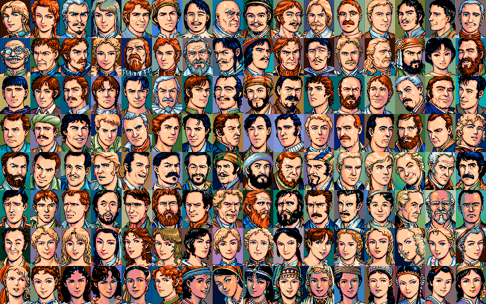

# 얼굴 그림 — KAO.LZW (KOUKAI2.EXE)

옮긴 자리: `Uw2.Support/Local/Formats/KaoImages.cs` · 구운 것 `asset/kao/faces.png` · `finds.png`.

## 묶음

LS 묶음, 청크 **256개** — 1,920바이트 128개(0~127)와 864바이트 128개(128~255).

| 청크 | 크기 | 것 |
|---|---|---|
| 0~127 | 64 x 80 | **얼굴**. 0~5 가 주인공(사람 표 차례: 조안 · 카탈리나 · 옷토 · 에르네스트 · 피에트로 · 알) |
| 128~255 | 48 x 48 | **발견물 그림** — 새 · 판다 · 공룡 따위 |

## 찍는 손 — 0x00434E70(x, y, 번호)

`KAO.LZW` 는 `0x0043A740` 이 미리 열어 `0x0046E4B0` 읽개에 둔다. 찍을 때 `0x0041C300` 으로 청크를 `0x0046F8F0` 담개에
읽고 `0x00401060(x, y, 8, 0x50, 담개, 0)` 로 넘긴다 — 가로 8바이트 = 64점, 세로 80줄.

## 꼴

1,920 = 64 x 80 x 3 / 8 — **면 셋(8색)**. 면이 줄마다 나뉘지 않고 **8점 토막마다 바이트 셋이 붙어 있다.**

```
바이트 = 줄 x (가로/8 x 3) + 토막 x 3 + 면
비트   = 7 - x % 8                    MSB 먼저
색인   = 면0 | 면1<<1 | 면2<<2          0~7
```

864 바이트 청크도 같은 꼴로 48 x 48 이다. 예전 기록이 「겹판 · 꽉채움에 48x80 · 64x60 · 80x48 다 대 봐도 어긋난다」고
했던 것은 면을 줄 단위(또는 통째)로만 대 봐서였다.



색은 항해 화면 팔레트(`GamePalette.SeaScreen`) 앞 여덟 칸을 그대로 댔다. **얼굴 창의 팔레트가 따로 있는지는 아직 안 봤다** —
피부가 주황빛으로 짙은 것이 그 탓일 수 있다.


