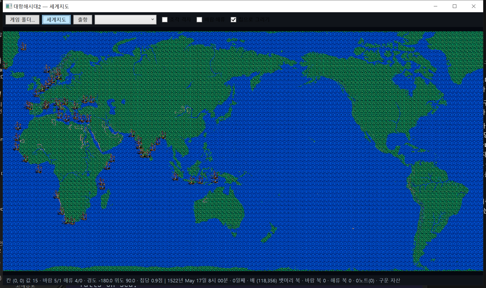

# 함대 표와 뱃길 (KOUKAI2.EXE)

옮긴 자리: `StartData.Fleets`(`Uw2.Support/Local/Formats/StartData.cs`) · 그리기 `SeaMapRenderer.SetOthers`.

## 함대 표 — SDATA.DAT 0x247B, 0x85바이트 x 70

메모리 `0x0045BE08`, `0x0043AE20(번호)` 가 짚는다. 사람 `+0x2C` 가 그 사람의 함대 번호다.

| 번호 | 것 |
|---|---|
| 0 · 10 · 20 · 30 · 40 · 50 | 주인공 함대(조안 · 카탈리나 · 알 · 옷토 · 피에트로 · 에르네스트). **배가 없고 깃발 0** 으로 시작한다 |
| 1~9 · 11~19 … 51~59 | 그 나라의 남 함대 아홉씩 |
| 60~69 | 해적 |

| 자리 | 것 |
|---|---|
| +0 · +2 | x · y (칩 눈금, 낱말) |
| +0x04 · +0x06 | 목표 자리(`+0x0C & 0x2000` 이면 이리로 간다) |
| +0x08 · +0x0A | 목표 자리 둘째(`+0x0C & 0x8000`) |
| +0x0C | 뱃길 깃발 · 뱃길 차례(아래 셋 비트) |
| +0x0E | 비스듬히 가는 셈의 쌓임 값 |
| +0x10 ~ +0x17 | 뱃길 마디 넷(낱말, 고리) |
| +0x18 · +0x19 | 칸 안 걸음 (0~59) |
| +0x1A | 뱃머리 |
| +0x1B | 움직임 갈래 — 닿은 뒤의 일을 가른다(`0x004184B0`, 갈래표 `0x00418538`) |
| +0x1C | 갈래 0 에서는 고향 항구 번호(닿은 뒤 돌아갈 데), 갈래 5~8 에서는 따라갈 사람 |
| +0x27 | 닿을 때 `rand(8) + 8` |
| +0x26 | 머문 · 고향 항구 — 0 리스본 · 1 세빌리아 · 2 이스탄불 · 8 제노바 · 29 런던 · 33 암스테르담 |
| +0x29 | 깃발 — 비트 0 이 바다에 나와 있다 |
| +0x2A | 제독(사람 번호) |
| +0x2B ~ | 칸 9바이트 x 10 (선원 · 내구 지금/최대 · 역풍 · 돛 · ? · 배 번호 · 깃발) |

바다에 나와 있고 배가 있는 함대를 그린 것. 뭍 위 자리(항구에 든 함대)는 뺐다.

## 뱃길 그래프 — DATA1.LZW 4번 청크 (12,288바이트 = 마디 768 x 16), 5번 청크 = 쓰는 마디 수 622

`0x00415B4E` 가 `0x0046F898` 담개에 읽는다(`RouteGraph`). 0번 마디가 (116, 349) — 리스본 앞바다다.

| 자리 | 것 |
|---|---|
| +0 | x (낱말). 맨 윗 비트는 「제 함대가 아는 마디」 — `0x0041E360` 이 발견한 바다(`0x0049F040` 비트 판)로 세운다 |
| +2 | y |
| +4 ~ +0xB | 이웃 마디 넷(-1 없음) |
| +0xC ~ +0xF | 그 이웃까지의 값 넷(바이트, 거리의 네 배 남짓) |

이웃은 한쪽 길일 수 있다(578 줄). 길 찾기 `0x0043B9A0` 은 넓이 먼저 찾기로 값을 쌓는다 — 제 함대만 아는 마디로
가리고 남 함대는 다 쓴다. 우리는 같은 값으로 데이크스트라를 돌린다.

뱃길은 함대 기록에 **마디 넷의 고리**(+0x10 ~ +0x17, 차례 = `+0x0C & 7`, 넘길 때 `& 3`)로 든다. `+0x0C` 의 비트 4~7 이
남은 마디, 다 지나면 `0x4000` 을 세우고 목표 자리(+4 · +6)로 곧장 간다(`0x0043B8E0`).

남 함대의 뱃머리(`0x00448380`)는 목표 자리를 고른 뒤(위 표), 지금 자리와의 차를 **비스듬히 셈**(쌓임 값 +0x0E)해
`sign(dx)`, `sign(dy)` 를 3 x 3 표 `0x00461FFC` 로 방위로 바꾼다. 마디에 닿으면 다음 마디로(`0x0043B8E0`).

## 남 함대 빠르기 — 0x00418020

제 함대 셈(`0x00448520`)과 효율표는 같되 선원 · 짐을 안 보고 제독 하나의 항해 레벨 · 항해술을 쓴다.
해류는 걸음에 안 더하고 빠르기에서 더하고 뺀다(맞흐름 −, 순흐름 +). 자세한 것은 [[12.분석-항해 속도와 걸음]].

## 남은 것

- ~~뱃길 따라 움직이기~~ — `NpcFleet`. 틱마다 다 한 걸음, 바람 · 해류는 제 함대 자리의 것을 같이 쓴다(원본 그대로).
  뱃머리도 게임 그대로 선 긋기(쌓임 값 +0x0E, 마디가 바뀌면 `-(가로 차 / 2)`, 3 x 3 표 `0x00461FF8` = `7 0 1 / 6 8 2 / 5 4 3`)다.
- 새 목표 항구 고르기 — 지금은 처음 목표와 고향(+0x1C)을 오간다. 머무는 날은 `rand(8)+8`.
- 배 기록(22바이트, `0x00461560`)의 선종 — 지금은 칸의 내구 · 역풍 · 돛으로 선종을 어림한다(`GuessType`).
