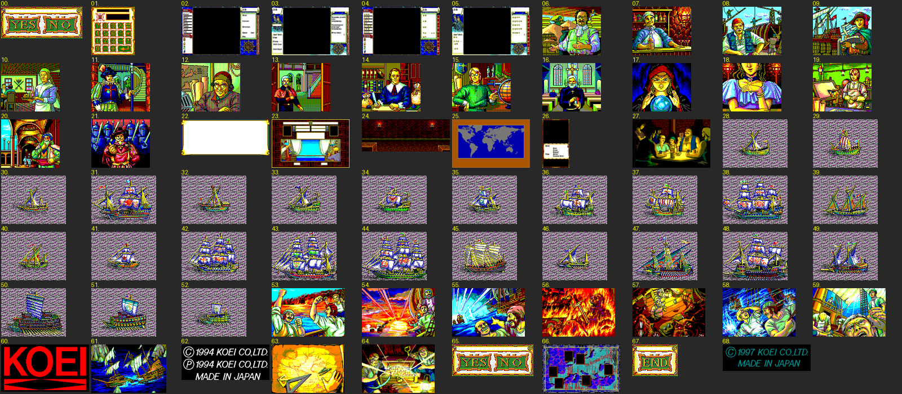
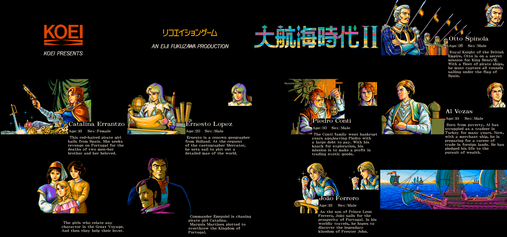

# NPK 그림 — GRAPH.DAT · END.DAT · OPEN.DAT

옮긴 자리: `Uw2.Support/Local/Formats/Npk.cs` · 구운 것 `asset/graph/NN.png`(예순아홉 장, 저마다 제 빛깔).



## 머리 0x30 바이트

| 자리 | 것 |
|---|---|
| +0x00 | `NPK016` |
| +0x06 | 면 수(4) |
| +0x08 | 화면 640 x 400 |
| +0x0C | 그림 가로 · 세로(워드) |
| +0x10 | 빛깔 열여섯 — 워드마다 `(G<<8) \| (R<<4) \| B`, 각 0~15 |

## 몸 — 0x0044D961

그림 찍는 손 `0x0043AC40(x, y, 번호, 갈래)` 가 `GRAPH.DAT` 를 읽어 화면 꼴(`0x0049FB84`)에 따라 푼다. 이 판은 꼴 3 이라
`0x0044D961` 이 돈다(꼴 7 의 `0x0044D692` 는 2 KB 창 LZSS 인데 이 파일들과는 안 맞는다).

네 점이 한 토막이고 줄마다 `(가로 + 3) / 4` 토막이다. 표지 바이트의 비트를 아래부터 하나씩 쓴다.

```
비트 0  날 토막 — 바이트 둘 (a, b). 점 넷이 각 바이트의 비트 7 · 3 에서 나온다.
        색 = a.7 x 8 + a.3 x 4 + b.7 x 2 + b.3   그 뒤 a · b 를 한 칸 왼쪽으로(넷 되풀이)
비트 1  되풀이 — 바이트 하나 c. (c & 0x1F) + 1 토막을 (c & 0x60) / 8 + 4 바이트 앞에서 베낀다.
        c.7 이 서면 거리는 「줄」이다(줄 너비 / 4 x 거리 = 1 ~ 4 줄 위).
```

원본은 다섯 줄 고리 버퍼에 풀어 한 줄씩 화면에 옮긴다. 다 풀면 읽은 바이트가 그림 크기와 꼭 맞는다(예순아홉 장 모두).

실행 파일의 자리 표 `0x004578A0`(자리, 길이 쌍)은 다섯째 장부터 이 `GRAPH.DAT` 와 어긋난다 — 머리 글자로 가른다.

## 무엇이 어디에

| 번호 | 것 | 찍는 곳 |
|---|---|---|
| 0 · 65 | 예 / 아니오 단추 | |
| 2 ~ 5 | 바다 화면 틀(영문 · 한글) | |
| 6 ~ 17 | **건물 임자** — 건물 번호 + 6 | `0x00436620` 이 (104, 16) 에 |
| 20 | 모스크 임자(교회 자리) | `0x00436620`, `0x00421910` 이 참이고 건물 10 이면 |
| 27 | 도박판 | `0x00426BF9` |
| 28 ~ 52 | 배 그림 | |
| 53 | 섬멸(말 0x341) | `0x0040B9C0(번호)` 가 (120, 32) 에 |
| 54 | 기함 이탈 · 적 퇴각 · 항복(0x234 ~ 0x236) | 〃 |
| 55 | 일몰(0x233) | 〃 |
| 56 | 날짜 말 0x3F9 와 함께(다른 싸움 끝) | 〃 |
| 57 | 쥐 떼(0x1D9) | `0x004179FF` |
| 58 | 날씨가 들이닥침(0x15E + 갈래 x 2) | `0x004193D0` |
| 59 | 괴혈병(0x1DA) | `0x00417B2B` |
| 63 | 세계지도 완성(0x1FB) | `0x00422185` |
| 64 | 보물 발견(0x1AF) | `0x0041BC1C` |
| 60 · 62 · 68 | KOEI 로고 · 판권 | |

## END.DAT · OPEN.DAT — 빛깔 없는 꼴

머리가 12 바이트뿐이다 — `NPK016`, 가로(+6), 세로(+8), 머리까지 친 길이(+0x0A). 몸은 위와 같은 꼴이라
`0x0042E060` 이 머리를 `0x0049A330` 에 베끼고 `0x00449FD1` 로 넘긴다. END.DAT 쉰다섯 장, OPEN.DAT 아흔 장이 모두 길이대로 꼭 풀린다.

빛깔은 실행 파일에 48 바이트씩 따로 있고 `0x0042E1E0` 이 받는다. 칸마다 **(B, R, G)** 순 0~15 다(사람 살빛으로 맞춰 봤다).

### 주인공 엔딩 — 0x00405B50

`0x0049F5AF`(사람 표 차례)로 갈래를 탄다.

| 주인공 | END.DAT 자리 | 빛깔 VA | 그림 |
|---|---|---|---|
| 0 조안 | 0x2C7F0 | 0x4545C0 | 누워 책을 읽는다 |
| 1 카탈리나 | 0x5DF1 | 0x4545F0 | 깃펜을 문다 |
| 2 옷토 | 0 | 0x456D00 | 뒷짐을 지고 기댄다 |
| 3 에르네스트 | 0x1C086 | 0x456D00 | 차를 내오는 이와 함께 쓴다 |
| 4 피에트로 | 0x280B6 | 0x454620 | 책상에 엎드린다 |
| 5 알 | 0xF50D | 0x456D00 | 둘이서 책을 본다 |


나머지 작은 장(눈 · 촛불)은 엔딩 그림 위에 겹쳐 움직이는 조각이다.

### 여는 화면 — 0x00431930

`OPEN.DAT` 을 열고 장면 손 열둘(`0x00459B38`)을 차례로 부른다. 하나가 글쇠를 받아 참을 돌려주면 나머지를 건너뛴다.
장면마다 (자리, 길이) 쌍과 빛깔을 민다 — 주인공 장면은 모두 `0x004591D0` 이고 이것 하나로 거의 다 맞아 `asset/open/` 은 이 빛깔로 굽는다.

| 장면 | 그림 |
|---|---|
| 0x0042E290 | KOEI PRESENTS |
| 0x0042E420 | 리코에이션 게임 · AN EIJI FUKUZAWA PRODUCTION |
| 0x0042EB30 | 大航海時代II · 「Here begins the glorious tale …」 |
| 0x0042F0C0 ~ 0x004304A0 | 옷토 · 카탈리나 · 에르네스트 · 피에트로 · 알(큰 그림 · 얼굴 · 영문 소개) |
| 0x00430930 · 0x00430E00 | 소녀들 · 에제키엘과 마르티네스 |
| 0x00431150 | 조안 |
| 0x00431690 | 배 · 「In the name of glory …」 |



`OpeningWindow` 가 큰 그림만 장면마다 4 초씩 넘긴다(눈 · 별 움직임은 뺐다). `--no-opening` 이면 안 띄운다.
